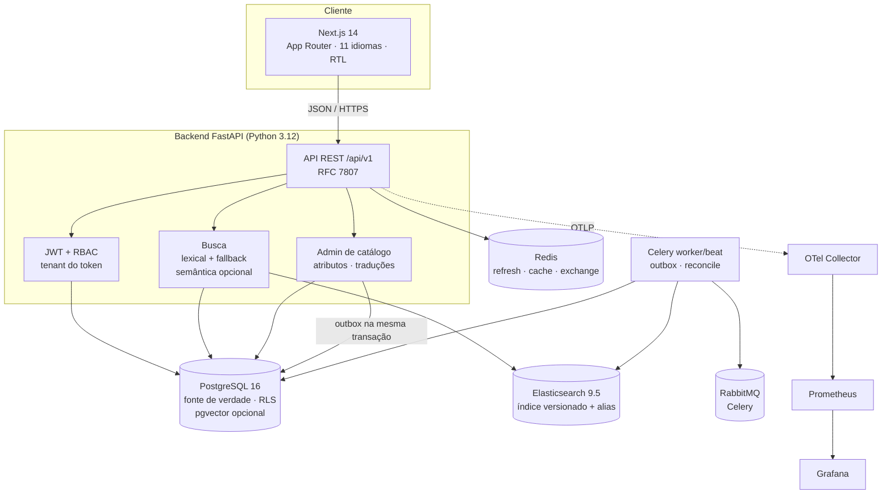
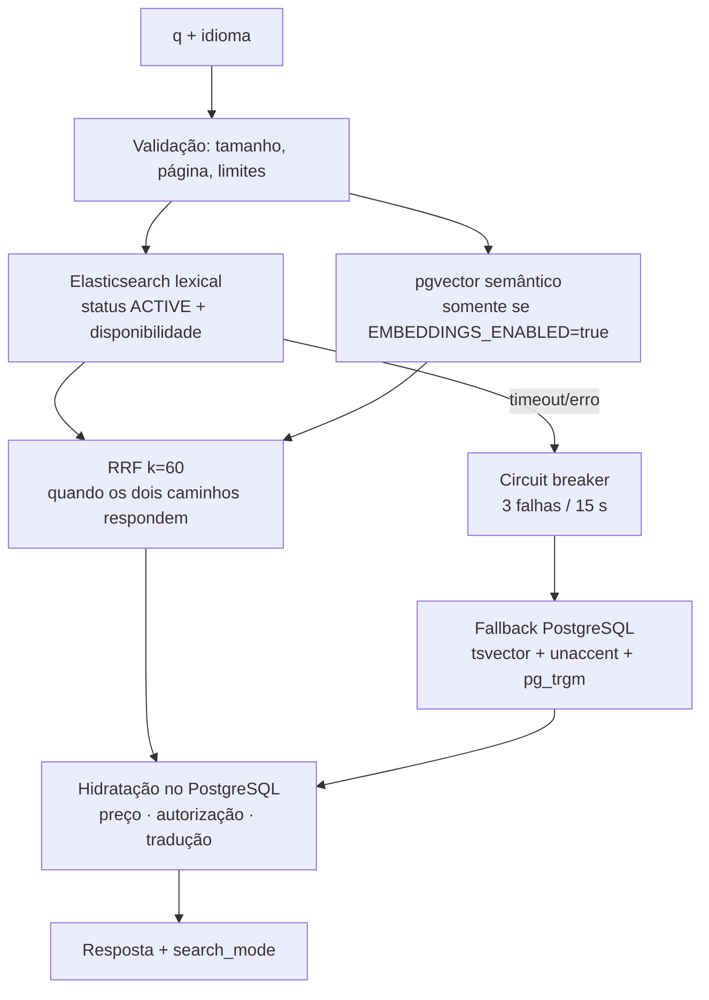
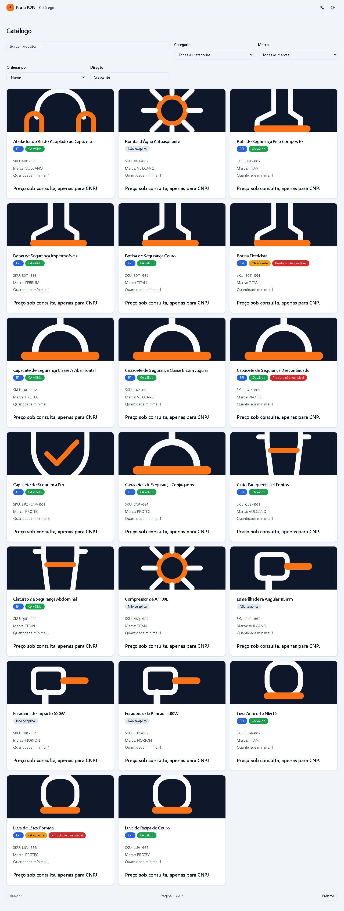
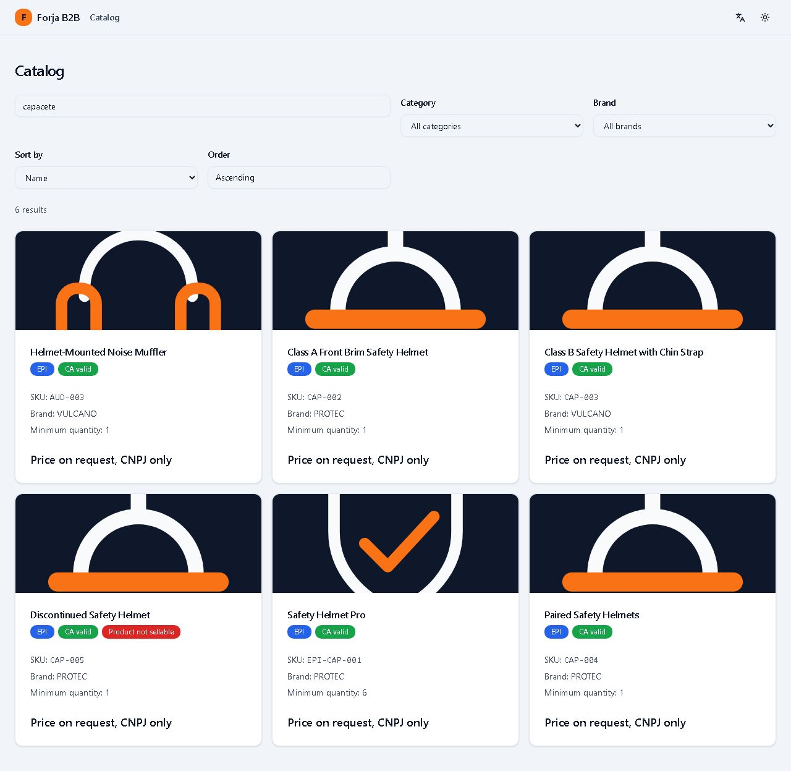
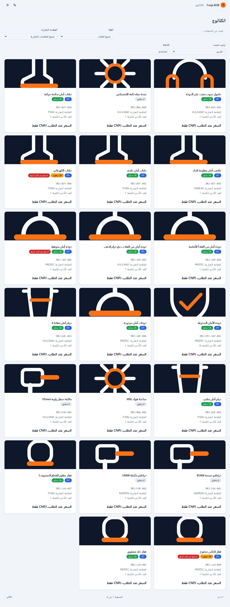
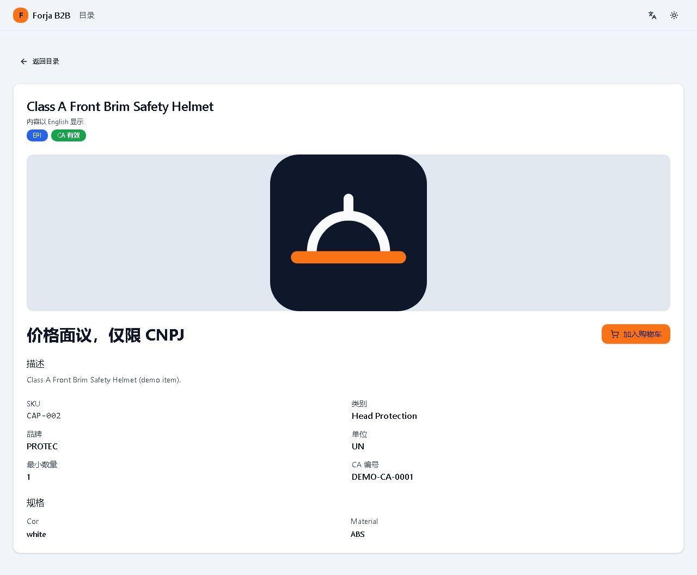

# Forja B2B

Plataforma de e-commerce B2B para **EPIs e máquinas industriais**, feita para empresas
(CNPJ) que compram em volume. Visitantes veem **preço sob consulta**; empresas
autenticadas veem o **preço negociado** da própria empresa. Catálogo, carrinho,
pedido, administração de catálogo, busca e conteúdo em vários idiomas.

> **Projeto de portfólio.** Todos os dados, marcas, CNPJs, preços, certificados (CA) e
> imagens de demonstração são **fictícios**. Nada aqui é uma oferta comercial real.
> O código não tem licença definida (ver [Licença](#licença)).

**English summary:** Forja B2B is a portfolio e-commerce platform for industrial PPE and
machinery. It pairs a FastAPI/PostgreSQL multi-tenant backend (row-level security) with a
Next.js storefront in 11 UI languages, company-specific pricing, catalog administration and
a lexical search path with a PostgreSQL fallback. All demo data is fictional. The optional
pgvector/RRF semantic path is implemented but **disabled by default**.

[](https://github.com/ViChagas07/ForjaB2B/actions/workflows/ci-backend.yml)
[](https://github.com/ViChagas07/ForjaB2B/actions/workflows/ci-frontend.yml)
[](https://github.com/ViChagas07/ForjaB2B/actions/workflows/ci-architecture.yml)


## O que é o Forja B2B

O fluxo é o de um marketplace B2B: uma empresa se cadastra com CNPJ, é aprovada, recebe
condições comerciais e compra em quantidades de atacado. O catálogo é global; o preço, a
visibilidade e a autorização são resolvidos por empresa no PostgreSQL.

- **Problema:** preço B2B não é preço de vitrine. Cada cliente negocia condição própria,
  e o preço não pode vazar entre empresas nem ser servido por um índice de busca.
- **Solução:** PostgreSQL como fonte de verdade, RLS por `company_id`, preço resolvido no
  servidor, índice de busca apenas com IDs e conteúdo público.
- **Demonstração:** 50 produtos, 11 categorias, 8 marcas fictícias, 4 empresas e 13 usuários
  de demonstração (dados do seed; contagens conferidas no banco em 2026-10-22).

## Funcionalidades

- **Catálogo:** categorias, marcas, produtos, imagens SVG por categoria, disponibilidade,
  estoque configurável por produto, compra direta e estado de CA (EPI vencido ou ausente não
  é vendável).
- **Busca:** lexical no Elasticsearch com prioridade para SKU, tolerância a acento e
  autocomplete; fallback textual no PostgreSQL. Semântica opcional com pgvector + RRF.
- **Preços por empresa:** regra negociada (preço fixo por produto) > desconto percentual
  (por categoria ou global) > preço de lista. Visitante recebe `price_on_request=true`.
- **Carrinho e pedido:** preços revalidados no servidor, snapshot do pedido, reserva de
  crédito e idempotência por chave única no banco.
- **Administração de catálogo:** criar, editar, publicar e despublicar produtos; atributos
  dinâmicos por categoria; imagem; concorrência otimista (409); trilha de auditoria;
  eventos na outbox de busca.
- **Traduções:** conteúdo armazenado em `en`, `es` e `ar` (origem `pt-BR`), com estados
  `machine`, `reviewed` e `stale`; interface em **11 idiomas**, incluindo RTL para árabe.
- **Conta e acesso:** login JWT, refresh com rotação, RBAC (`ADMIN`, `BUYER`, `APPROVER`,
  `FINANCE`), OAuth Google opcional.
- **Crédito, faturamento e pagamento:** ledger append-only, fatura/boleto simulado e
  gateway de pagamento **fake local** (PIX/cartão/boleto). Não há adquirente real.
- **LGPD:** exportação, retificação, anonimização e consentimento self-service.
- **Notificações:** outbox transacional + Celery/RabbitMQ + SMTP local (Mailpit).
- **Observabilidade:** logs JSON com `X-Request-ID`, métricas Prometheus, traces OTel e
  endpoints de health. O Compose local inclui OTel Collector, Prometheus e Grafana; há
  falhas conhecidas nessa stack (ver [Limitações](#limitações-conhecidas)).

## Arquitetura



A raiz de composição é `backend/app/main.py`. Os módulos seguem Clean Architecture
(`domain → application → infrastructure/interface`) e o import-linter impede dependências
cruzadas entre bounded contexts. PostgreSQL guarda preço, estoque, CA, autorização e
traduções; Elasticsearch e pgvector são **derivados e reconstruíveis**.

### Fluxo de busca



`search_mode` informa o caminho real: `hybrid`, `lexical`, `semantic_postgres` ou
`postgres_fallback`. Falha de infraestrutura não vira lista vazia silenciosa: o fallback é
usado e, se ambos falharem, a API responde erro. **Preço nunca entra no índice nem no vetor.**

## Decisões de destaque

| Decisão | Por quê | ADR |
| :--- | :--- | :--- |
| PostgreSQL é a fonte de verdade; multi-tenant com RLS | Preço e autorização não podem vazar nem depender de índice | [ADR-0005](docs/ADRs/0005-postgresql-fonte-de-verdade-rls.md) |
| Busca lexical + fallback; semântica opcional com RRF | Robustez com custo proporcional; o modo real é explícito | [ADR-0004](docs/ADRs/0004-busca-hibrida.md) |
| Preços fora do índice e preço consultivo | Isolamento por empresa e ausência de dado comercial no ES | [ADR-0006](docs/ADRs/0006-precos-fora-do-indice.md) |
| Traduções armazenadas, 11 idiomas de UI e 4 de conteúdo | Sem tradução em tempo de request; fallback campo a campo | [ADR-0007](docs/ADRs/0007-traducoes-armazenadas.md) |
| Atributos em JSONB com definições por categoria | Flexibilidade de catálogo sem EAV nem colunas por nicho | [ADR-0008](docs/ADRs/0008-atributos-jsonb.md) |
| Outbox, reconciliação e índice versionado com alias | Indexação não bloqueia o catálogo; rebuild e rollback seguros | [ADR-0009](docs/ADRs/0009-outbox-indice-versionado.md) |
| Rate limiting com Redis e fail-open | **Proposto, não implementado**; registrado para não simular controle | [ADR-0010](docs/ADRs/0010-rate-limiting-redis.md) |
| Idempotência por chave única | Evita pedido/pagamento duplicado em retry | [ADR-0011](docs/ADRs/0011-idempotencia.md) |
| Timeouts curtos e circuit breaker na busca | Degradar em ~2 s, não em ~15 s | [ADR-0012](docs/ADRs/0012-timeouts-circuit-breaker.md) |
| Observabilidade proporcional e segredos fora do Git | Diagnóstico sem acoplar o projeto a um vendor | [ADR-0013](docs/ADRs/0013-observabilidade-segredos.md) |

## Estado de validação

A tabela abaixo separa o que foi **executado e observado** do que é apenas
**implementado**, **validado em outra sessão** ou **não validado**. Datas e comandos são
os desta sessão (2026-10-22), salvo indicação.

| Área | Estado | Evidência |
| :--- | :--- | :--- |
| Backend: unidade + arquitetura | ✅ Validado | `pytest tests/unit tests/architecture` → **425 passed** |
| Backend: suíte sem Docker | ✅ Validado | `DOCKER_HOST` inacessível → **427 passed, 251 skipped** (integração pulada) |
| Backend: suíte completa com Docker | ✅ Validado | `pytest tests/` → **677 passed, 1 skipped** (Testcontainers) |
| Ruff | ✅ Validado | `ruff check` OK; `ruff format --check` → **384 files already formatted** |
| Mypy no código de aplicação | ✅ Validado | `mypy app --strict` → **285 files, 0 errors** |
| Mypy no repositório (o que o CI executa) | ❌ Falha conhecida | `mypy .` → **48 errors em 5 arquivos de teste**; o job `ci-backend` roda `mypy .` |
| Import-linter | ✅ Validado | **4 contratos mantidos, 0 quebrados** |
| Frontend: tipos e lint | ✅ Validado | `npm run typecheck` OK; `npm run lint` OK com 3 warnings `` |
| Frontend: testes e build | ✅ Validado | **102 passed**; `npm run build` concluiu |
| Docker Compose (sintaxe) | ✅ Validado | `docker compose --env-file .env.example config --quiet` OK |
| Docker Compose (runtime) | ⚠️ Parcial | 9 containers healthy e 2 em restart (`forja-grafana`, `forja-celery-beat`); `forja-frontend` criado, não iniciado (detalhes abaixo) |
| Busca lexical, multilíngue e fallback | ✅ Validado em sessão anterior | Evidência V2 em [PROGRESS](docs/agent/PROGRESS.md): `en`/`es`/`ar`, SKU, `postgres_fallback` com ES parado, latências e recuperação. **Não reexecutado nesta sessão.** |
| Busca semântica (`hybrid`) | ⚠️ Não validado no estado padrão | `EMBEDDINGS_ENABLED=false`; houve validação local na Fase 7, mas não é o padrão nem foi validada em produção |
| i18n visual (11 idiomas, RTL) | ✅ Evidência existente | 16 capturas em [`docs/validation/v3/`](docs/validation/v3/) e spec Playwright com **5 passed** (registro em PROGRESS); **não reexecutado nesta sessão** |
| CI no GitHub | ⚠️ Não verificado | Workflows existem ([backend](.github/workflows/ci-backend.yml), [frontend](.github/workflows/ci-frontend.yml), [arquitetura](.github/workflows/ci-architecture.yml)); nenhum run foi consultado. O mypy local sugere que o job backend falha. |
| Deploy em provedor | ❌ Não executado | Não há `render.yaml`, URL pública nem deploy registrado; ver [DEPLOY_RENDER](docs/DEPLOY_RENDER.md) |
| Teste de carga | ❌ Não executado | Não há k6/Locust nem resultados versionados; ver [LOAD](docs/testing/LOAD.md) |
| Licença | ❌ Ausente | Não há `LICENSE`; sem licença, vale o padrão de todos os direitos reservados |

### O que está deliberadamente desligado

- **Embeddings:** `EMBEDDINGS_ENABLED=false` no `.env.example` e no padrão do código. O
  caminho `hybrid` existe, mas não é o estado de produção deste repositório.
- **Pagamento real:** `FakePaymentGateway` gera referências determinísticas; não há
  adquirente, conciliação ou webhook de terceiro real.
- **OAuth Google:** opcional; sem credenciais, os endpoints retornam 503 e o botão fica
  oculto.
- **Rate limiting:** **não implementado**. O Redis é usado para refresh, cache, OAuth
  state/exchange e readiness; não há middleware de limite de requisições.

## Como rodar localmente

Pré-requisitos: Docker com Compose v2, Python 3.12 (para rodar testes fora do container)
e Node.js 20+ (frontend). O `.env.example` contém **apenas valores fictícios de
desenvolvimento**; não reuse em produção.

```bash
# 1. Ambiente
cp .env.example .env
# Edite .env se quiser; DEMO_USER_PASSWORD habilita os usuários de demonstração.

# 2. Stack (PostgreSQL, Redis, RabbitMQ, Mailpit, Elasticsearch, backend, workers,
#    OTel/Prometheus/Grafana)
docker compose up -d
docker compose ps

# 3. Migrations (role administrativa, container one-off)
make migrate

# 4. Seed idempotente (catálogo, empresas, usuários, preços e traduções)
make seed

# 5. Definições de atributos por categoria (idempotente)
docker compose run --rm --no-deps --env-file .env backend \
  python scripts/seed_attribute_definitions.py

# 6. Índice de busca (ajuste a versão ao mapping atual; hoje v2)
docker compose exec backend python -m app.modules.search.interface.cli bootstrap --version 2
docker compose exec backend python -m app.modules.search.interface.cli reindex --version 2
docker compose exec backend python -m app.modules.search.interface.cli reconcile

# 7. API
# http://localhost:8000/docs (somente fora de produção)
# http://localhost:8000/health/live · /health/ready · /health/search

# 8. Frontend
cd frontend
npm ci
npm run dev   # http://localhost:3000
```

> **Proxy same-origin:** o navegador chama `/api/v1` na própria origem do frontend; o
> Next encaminha para `BACKEND_URL` (variável somente de servidor). O CORS do backend
> continua configurado para chamadas diretas em desenvolvimento. Em produção é preciso
> definir `BACKEND_URL` no painel da Vercel e refazer o deploy, pois os rewrites são
> resolvidos no build.

### Usuários de demonstração

O seed só cria usuários se `DEMO_USER_PASSWORD` estiver definida (o `.env.example` traz um
valor fictício). A senha é a mesma para todos; nunca versione uma senha real.

| Empresa | Usuário | Papel |
| :--- | :--- | :--- |
| Empresa Exemplo | `admin@exemplo.com.br` | ADMIN |
| Empresa Exemplo | `comprador@exemplo.com.br` | BUYER |
| Metalúrgica Demo Alfa | `comprador@metalurgica-alfa.example.com` | BUYER |
| Construções Demo Beta | `comprador@construcoes-beta.example.com` | BUYER |
| Indústria Demo Gama | `comprador@industria-gama.example.com` | BUYER |

As três empresas demo têm condições diferentes: Alfa sem desconto; Beta 10% em proteção da
cabeça; Gama 5% global + preço negociado em `CAP-002` e `BOT-001`. Visitante sempre recebe
preço consultivo.

### O que foi (e não foi) testado em ambiente limpo

`docker compose config` foi validado. A suíte completa foi executada sobre a stack Docker
existente. **Não** foi feito um bootstrap do zero com volumes novos nesta sessão: apagar ou
recriar volumes é proibido pelas regras do projeto (`down -v`/`volume rm`). Portanto, o
roteiro acima é o procedimento documentado, mas a criação de um ambiente totalmente limpo
continua **NÃO VALIDADA**.

## Qualidade

```bash
# Backend (na pasta backend, com .venv Python 3.12)
pytest tests/unit tests/architecture -q   # 425 passed
pytest tests/ -q                          # 677 passed, 1 skipped (Docker/Testcontainers)
DOCKER_HOST=tcp://127.0.0.1:1 pytest tests/ -q  # 427 passed, 251 skipped
ruff check . && ruff format --check .     # OK / 384 files
mypy app --strict                         # 285 files, 0 errors
mypy .                                    # 48 errors em testes (falha conhecida)
lint-imports --config .import-linter      # 4/4

# Frontend (na pasta frontend)
npm run typecheck && npm run lint
npm run test                              # 102 passed
npm run build
```

- **CI:** `.github/workflows/ci-backend.yml`, `ci-frontend.yml` e `ci-architecture.yml`.
  O status real dos runs não foi consultado nesta sessão.
- **Testes de carga:** não executados; ver [`docs/testing/LOAD.md`](docs/testing/LOAD.md).
  Nenhum número de carga é apresentado neste README.
- **Simulações de falha:** o fallback sem Elasticsearch foi validado na V2 (ES parado,
  `search_mode=postgres_fallback`, recuperação após `start` + `reconcile`) e está
  documentado em [`docs/search/RUNBOOK.md`](docs/search/RUNBOOK.md) e no
  [`PROGRESS`](docs/agent/PROGRESS.md). Não foi reexecutado nesta sessão.

## Segurança e privacidade

- **Segredos:** nenhum segredo real no repositório; `.env` é ignorado. O `.env.example` tem
  apenas valores de desenvolvimento.
- **Multi-tenant:** RLS `FORCE ROW LEVEL SECURITY` em tabelas de domínio; `company_id` vem
  do JWT, nunca de parâmetro do cliente. Roles `forja_app`/`forja_admin` sem `BYPASSRLS`.
- **Autenticação:** JWT HS256 curto, refresh com rotação no Redis, Argon2id para senhas,
  OAuth Google com `state` e exchange code de uso único.
- **Pagamento:** webhook HMAC-SHA256 sobre o corpo bruto, `company_id` dentro do payload
  assinado.
- **LGPD:** exportação, retificação, anonimização e consentimento; a exclusão preserva
  registros financeiros/fiscais e auditoria.
- **Limite honesto:** não há WAF, rate limiting, Vault, SOC 2 ou ISO 27001. Ver
  [SECURITY.md](docs/SECURITY.md), [LGPD.md](docs/LGPD.md) e
  [NON_GOALS.md](docs/NON_GOALS.md).

## Observabilidade

- Logs estruturados em JSON com `X-Request-ID` e `trace_id`; erros RFC 7807 sem stack trace.
- Métricas Prometheus em `/metrics`: HTTP, pedidos, pagamentos, notificações e busca por
  `search_mode`.
- Traces OTLP para o collector do Compose, com instrumentação FastAPI e SQLAlchemy.
- Health: `/health/live`, `/health/ready`, `/health/search` (a indisponibilidade do
  Elasticsearch não derruba o readiness).
- **Estado local:** `forja-grafana` reinicia por provisioning inválido de datasource
  (dois defaults) e `forja-celery-beat` reinicia por permissão de escrita em
  `celerybeat-schedule`. Os demais containers estão healthy. Isso é uma falha de
  infraestrutura local, não uma validação de produção.

## API

A API é FastAPI e o contrato é versionado em `/api/v1`.

- Contrato versionado: [`docs/api/openapi.json`](docs/api/openapi.json)
- Documentação estática (Redoc): [`docs/api/index.html`](docs/api/index.html)
- Política de versionamento/depreciação: [`docs/API_VERSIONING.md`](docs/API_VERSIONING.md)
- Webhooks: [`docs/WEBHOOKS.md`](docs/WEBHOOKS.md)
- Tipos TypeScript gerados: `frontend/core/domain/api-schema.d.ts`
- Mapa de endpoints por contexto: [`docs/API.md`](docs/API.md)
- Cupons (regras, cálculo, endpoints e admin): [`docs/COUPONS.md`](docs/COUPONS.md)

Localmente:

- Swagger UI: `http://localhost:8000/docs`
- OpenAPI JSON: `http://localhost:8000/openapi.json`
- Regenerar o snapshot: `cd backend && python scripts/export_openapi.py`
- Regenerar os tipos: `cd frontend && npm run openapi:types`

Em produção (`ENVIRONMENT=production`), `/docs` e `/openapi.json` são desligados por
padrão; publique o HTML estático ou sirva o snapshot.

Erros seguem Problem Details (RFC 9457) em `application/problem+json`, com
`request_id` e `errors[]` por campo nas validações. Mutações críticas exigem o
header `Idempotency-Key` (16–128 caracteres): repetição com o mesmo payload
devolve a resposta original e `Idempotent-Replayed: true`; payload diferente
responde 422; requisição em andamento responde 409 com `Retry-After`.

## Deploy

Não há deploy executado nem configuração de provedor versionada. O roteiro e as pendências
para um deploy no Render estão em [`docs/DEPLOY_RENDER.md`](docs/DEPLOY_RENDER.md). O
`docker-compose.prod.yml` cobre apenas o Elasticsearch com TLS/API key e réplicas para uma
VPS; ele **não** é um plano de deploy completo.

## Limitações conhecidas

1. **CORS implementado** e configurável por `CORS_ORIGINS`; o domínio real ainda precisa
   ser definido no deploy.
2. **`mypy .` falha** em 48 erros de tipagem em testes; o job de CI roda `mypy .`. O código
   de aplicação (`mypy app --strict`) está limpo.
3. **Grafana e celery-beat** reiniciam no Compose local (provisioning e permissão de
   arquivo). Isso atrasa a reconciliação automática da busca.
4. **Rate limiting implementado** (Redis com fallback local); ainda não há WAF/edge.
5. **Idempotência no header** `Idempotency-Key` nas rotas críticas; o campo
   `idempotency_key` no corpo continua aceito como fallback depreciado.
6. **Busca semântica desligada** por padrão (`EMBEDDINGS_ENABLED=false`); o modo `hybrid`
   não é o padrão e não foi validado em produção. O fallback PostgreSQL busca apenas
   `pt-BR`.
7. **Traduções não revisadas por falante nativo** (especialmente árabe). São demonstração.
8. **Pagamento fake**, sem adquirente real, conciliação ou estorno.
9. **Deploy e carga não executados**; não há números de produção nem de carga.
10. **Licença indefinida**; sem `LICENSE`, o código está sob todos os direitos reservados
    por padrão.
11. **Três produtos do seed** (`EPI-LUV-002`, `EPI-RES-003`, `MAQ-PAR-004`) têm descrição
    nula; a API admin exige descrição para novos produtos, mas o dado legado permanece.
12. **`.commandcode/` versionado:** arquivos de ferramentas do agente estão no índice do
    Git. Não foram alterados nesta entrega; o responsável deve decidir se devem sair do
    repositório.

## Capturas de tela

As capturas abaixo são reais, geradas na validação visual de i18n (Chromium, 2026-10-22).
Não são mockups. O conjunto completo (16 imagens: pt-BR, en, ar e zh-CN × catálogo, busca,
detalhe e carrinho) está em [`docs/validation/v3/`](docs/validation/v3/).

| Catálogo (pt-BR) | Busca (en) |
| :---: | :---: |
|  |  |

| Catálogo (árabe, RTL) | Detalhe (zh-CN) |
| :---: | :---: |
|  |  |

> As capturas foram feitas com a checagem de CORS do Chromium desativada porque o backend
> ainda não envia cabeçalhos CORS. Isso está documentado e não esconde a lacuna.

## Licença

**[A DEFINIR pelo responsável]** — não há arquivo `LICENSE` neste repositório. Sem uma
licença explícita, o código tem **todos os direitos reservados** por padrão; não é
open source. A escolha da licença é uma decisão do responsável, não deste projeto.

## Documentação

O mapa completo está em [`docs/INDEX.md`](docs/INDEX.md). Atalhos:

- [Arquitetura](docs/ARCHITECTURE.md) · [Status atual](docs/STATUS.md) · [Não-objetivos](docs/NON_GOALS.md)
- [ADRs](docs/ADRs/) · [Busca (runbook)](docs/search/RUNBOOK.md) · [i18n](docs/I18N.md)
- [Segurança](docs/SECURITY.md) · [LGPD](docs/LGPD.md) · [Catálogo/admin](docs/CATALOG_ADMIN.md)
- [API](docs/API.md) · [Testes de carga](docs/testing/LOAD.md) · [Deploy Render](docs/DEPLOY_RENDER.md)
- [Relatório final de prontidão](docs/readiness/FINAL_REPORT.md) · [Histórico](docs/history/)
